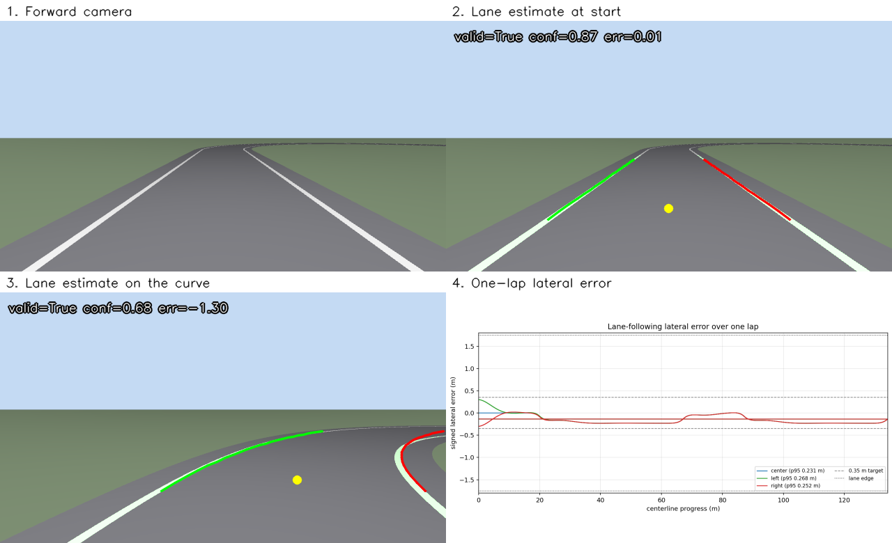
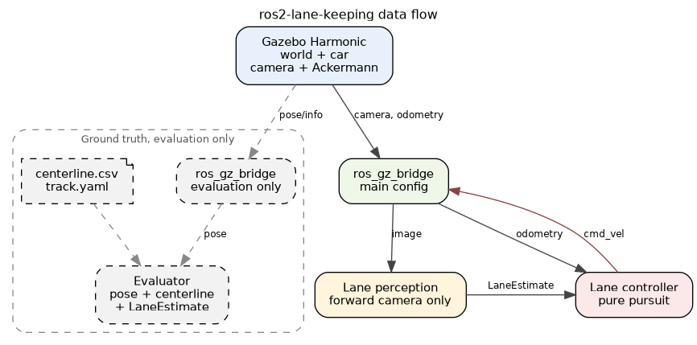
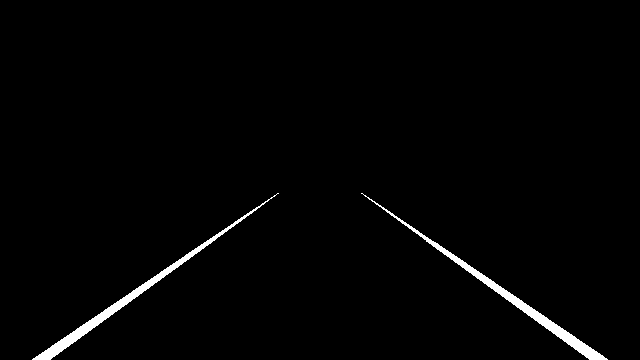

# ros2-lane-keeping

A ROS 2 Jazzy and Gazebo Harmonic project where a small car follows a painted
lane using only its forward camera.



## Results

Release target: all three starting positions complete a lap, no part of the
car footprint crosses a lane boundary, and the 95th-percentile absolute lateral
error stays below 0.35 m.

| Scenario | Lap | Lap time | p95 error | Max error | Crossing | Valid | Stops |
|---|---:|---:|---:|---:|---:|---:|---:|
| center | yes | 87.88 s | 0.231 m | 0.232 m | no | 100% | 0 |
| left +0.3 m | yes | 87.89 s | 0.262 m | 0.300 m | no | 100% | 0 |
| right −0.3 m | yes | 87.87 s | 0.256 m | 0.300 m | no | 100% | 0 |

**Docker is the supported release environment. Release target: PASS.**

- Tested in Docker on macOS arm64.
- Ubuntu 24.04.5 arm64.
- ROS 2 Jazzy.
- Gazebo Sim 8.15.0.
- Track version 1, 134.248 m centerline, 3.5 m lane.
- Demo and evaluation run: commit `c2c2fb5`, 1.5 m/s, lookahead gain 1.2, 90°
  camera.

A native Ubuntu 24.04 ARM64 VM was also tested with Lima and Apple
Virtualization. It builds, passes the 50 tests present in that revision, and
produces valid camera frames, but runs at 4.5–5.4 Hz under Mesa llvmpipe. All
three scenarios fail there because camera gaps trigger the 0.3 s stale stop and
perception does not always recover. The VM is not supported for release runs.
The failure is kept for reference in [`docs/environment.md`](docs/environment.md)
and [`results-vm/summary.md`](results-vm/summary.md).

The same three scenarios also pass on track version 2, which has 3 m dashed
boundaries, 0.75 m gaps, and every third dash worn. All three laps completed
and perception was fresh-valid for 100% of messages. The p95 lateral errors
were 0.232 m (center), 0.245 m (left), and 0.270 m (right). Center and left had
4 and 5 brief stale-frame stops; right had none. Raw results are in
[`results-markings/`](results-markings/).

The low-sun shadow world also passes the release target. All three laps
completed with p95 errors of 0.230 m (center), 0.249 m (left), and 0.300 m
(right), and no boundary crossings. Fresh-valid perception was 96.4–96.9%,
with 8–10 stop events. The six labeled shadow frames all pass; the largest
lateral error against ground truth is 0.014 m and the largest width error is
0.057 m. A 0.25 s hold of the last valid estimate bridges brief dropouts; the
controller still stops when the estimate is older than 0.3 s. Raw results are
in [`results-lighting/`](results-lighting/).

Raw Docker results are in [`results/`](results/). The method and tuning record
are in [`docs/evaluation.md`](docs/evaluation.md).

## How it works



- **Perception** uses only `/car/camera/image_raw`. It projects bright marking
  pixels onto the ground plane, fits the two white boundaries, and publishes a
  lane center and a 4 m camera lookahead target.
- **Controller** uses only `LaneEstimate` and odometry. It applies pure pursuit,
  a speed ramp, curvature and yaw limits, and a yaw smoother. It stops on an
  invalid, missing, or stale estimate.
- **Evaluator** is a separate process. It reads Gazebo model pose and the
  generated centerline for scoring. Neither perception nor control can see
  those inputs.

The data flow, ground-truth isolation, and equations are in
[`docs/architecture.md`](docs/architecture.md). Perception stages are in
[`docs/perception.md`](docs/perception.md). Control parameters are in
[`docs/control.md`](docs/control.md).

The binary white-marking mask (sky hidden) looks like this:



## Prerequisites

- Ubuntu 24.04 ARM64, or Docker on Apple Silicon
- ROS 2 Jazzy
- Gazebo Harmonic through `ros-jazzy-ros-gz` vendor packages
- Python 3.12, OpenCV, NumPy, PyYAML

The road, car, and world assets are committed. The project does not download
Gazebo Fuel models.

## Setup

Docker is the tested path:

```bash
./docker/run.sh
```

Inside the container:

```bash
colcon build --symlink-install
source install/setup.bash
python3 -m pytest -q tests
```

For a native Ubuntu 24.04 ARM64 install, including the exact ROS and Gazebo
packages, see [`docs/setup.md`](docs/setup.md).

## Run

Headless demo:

```bash
ros2 launch auto_drive_sim demo.launch.py gui:=false
```

The car starts driving by itself. `Ctrl-C` stops it. `gui:=true` needs a
display and is not tested in Docker.

Live Foxglove view:

```bash
./docker/run.sh bash -lc \
  'source install/setup.bash && ros2 launch auto_drive_sim demo.launch.py gui:=false foxglove:=true'
```

Open Foxglove.app, connect to `ws://localhost:8765`, and add image panels for
`/car/camera/image_raw` and `/car/debug_image`. Add plots for
`/car/lane_estimate` and `/car/cmd_vel`. The full panel guide is in
[`docs/interface.md`](docs/interface.md).

Run only perception:

```bash
ros2 launch auto_drive_sim perception.launch.py gui:=false
ros2 topic echo /car/lane_estimate
```

Manual drive:

```bash
ros2 launch auto_drive_sim manual_drive.launch.py gui:=false
ros2 run auto_drive_sim teleop
```

## Tests and evaluation

Fast tests:

```bash
./docker/run.sh bash -lc 'python3 -m pytest -q tests'
```

The suite has 68 tests: track geometry, car and bridge limits, perception
frames and rejection cases, pure-pursuit behavior, and evaluator geometry.

Run the three release scenarios:

```bash
./docker/run.sh bash -lc 'tools/run_scenarios.sh'
cat results/summary.md
```

Each scenario takes a few minutes because it runs one simulated lap.

## Repository layout

```text
ros2-lane-keeping/
├── src/
│   ├── auto_drive_sim/                 # nodes, config, launch, models, worlds
│   └── auto_drive_sim_interfaces/      # LaneEstimate.msg
├── tools/                              # track, capture, drive, evaluation tools
├── tests/                              # unit tests and saved camera frames
├── results/                            # solid-track scenario JSON, CSV, summary
├── results-markings/                   # dashed and worn track scenario results
├── results-lighting/                   # low-sun shadow scenario results
├── results-vm/                         # native VM result (failed target)
├── docker/                             # Ubuntu 24.04 + ROS 2 Jazzy image
└── docs/                               # setup, architecture, track, car,
                                        # perception, control, evaluation
```

The ROS package names still use `auto_drive_sim`. I kept them to avoid a risky
rename. The project name is ros2-lane-keeping.

## Known limitations

- The passing results are from Docker on macOS, which is the supported release
  environment. The native VM was tested and failed the scenario target under
  software rendering; it is not supported for release runs.
- The track is a clean, flat, one-lane oval. The dashed variant uses 3 m
  dashes with 0.75 m gaps and light wear. Long gaps, heavy wear, and wet
  markings are not tested.
- The dashed and shadow runs have brief stale-frame stops. They do not fail the
  lap target, but the stop counts are higher than the solid track.
- Low-sun shadows pass with 8–10 stop events. Perception holds the last valid
  estimate for up to 0.25 s; a longer loss still stops the car. A fallback that
  drove from one visible boundary was tested and rejected because it left the
  lane in one run.
- Speed is constant at 1.5 m/s. There is no curve speed planning.
- The controller stops on any perception gap instead of coasting through it.
- There is no traffic, weather, occlusion, or obstacle handling.
- Meeting the target on this track is not a claim of road-ready autonomy.

## Next

Add recovery after longer perception loss and reduce the remaining stale-frame
stops. Then add curve speed planning and smoother steering, followed by
multiple lanes and traffic. A learned detector comes only after there is a
dataset and a fixed evaluation protocol.

## License

MIT. See [`LICENSE`](LICENSE).
