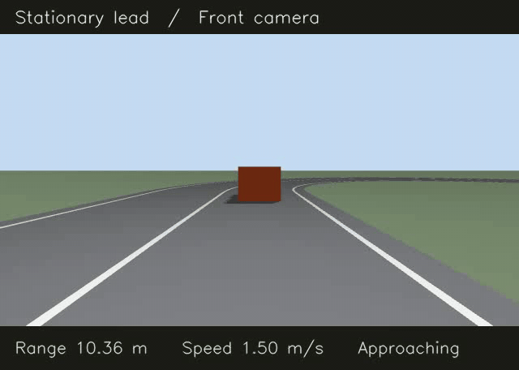

# ros2-lane-keeping

I started this project to see if a car in Gazebo could stay in a painted lane
using a front-facing camera. It now follows straight and curved lanes, adjusts
its speed for bends, and can follow a lead vehicle. I use ROS 2 Jazzy, Gazebo
Harmonic, and Python. On an empty two-lane test road, it can also select a lane
and make a requested lane change.



The red box represents a stationary lead vehicle. The overlay shows what the
camera estimates for range and how the car slows to a stop.

## Results

For lane keeping, I count a run as a pass if the car completes the lap, its
footprint stays inside the lane, and the 95th-percentile lateral error is
below 0.35 m.

| Native Gazebo run | Laps | Worst p95 lateral error | Boundary crossings | Commanded stops |
|---|---:|---:|---:|---:|
| Tight oval, worn markings, daylight | 3/3 | 0.273 m | 0 | 0 |
| Original worn oval, low sun | 3/3 | 0.233 m | 0 | 0 |
| Tight oval, worn markings, low sun | 3/3 | 0.274 m | 0 | 0 |

Shadows were the first condition that made the car stop repeatedly. After
adding a contrast fallback to lane detection, stops on the original low-sun
track went from 24 to 1 across three laps. The repeat above finished with zero
stops. [Perception notes](docs/perception.md) · [Lane-keeping results](docs/evaluation.md#native-scenario-validation)

I also automated four **longitudinal control** checks on the two-lane road:

- **Stationary lead.** The car stopped at a camera range of 5.98 m against a 6.0 m setpoint.
- **Moving lead.** The car followed for 60 simulated seconds and held a camera range of 7.25–7.38 m over the final 10 seconds.
- **Braking lead.** The lead slowed from 1.0 to 0.45 m/s and then stopped. The car settled at a camera range of 5.98 m.
- **Detector outage.** The controller commanded zero speed 0.516 seconds after the last usable frame.

Both scripted lane changes crossed the divider once with no stops or road-edge
crossings. The car settled within 2.1 cm of the target lane center.

[Lane maneuver results](results-native-maneuvers/lanes/summary.md) · [Lead-vehicle results](results-native-maneuvers/lead/summary.md) · [Docker baseline](results/summary.md)

At an empty intersection, the car stopped at the painted line, waited about
two seconds, and reached its route goal within 10 cm. With the line removed,
it stopped before entering the intersection. [Intersection results](results-native-intersection/summary.md)

## How it works

- **Lane detection** estimates both boundaries and the lane center from the front camera.
- **Lateral control** uses pure pursuit to steer toward a point ahead on the estimated centerline.
- **Longitudinal control** adjusts speed for curves. With lead following enabled, it also limits speed based on the camera range to the lead vehicle.
- **Evaluation** uses Gazebo ground truth to score lane error and vehicle separation independently of the driving logic.

[Architecture](docs/architecture.md) · [Perception](docs/perception.md) · [Control](docs/control.md)

## Prerequisites

Docker uses Ubuntu 24.04 with ROS 2 Jazzy, Gazebo Harmonic, Python 3.12, and
OpenCV. The native Apple Silicon setup uses Python 3.11 and Gazebo with Metal.
[Native macOS setup](docs/native_macos.md)

## Setup

From the repository root, start the Docker environment:

```bash
./docker/run.sh
```

Inside the container:

```bash
colcon build --symlink-install
source install/setup.bash
```

[Ubuntu setup](docs/setup.md) · [Apple Silicon setup](docs/native_macos.md#build-and-verify)

## Run

Start the headless driving demo from the sourced ROS workspace:

```bash
ros2 launch auto_drive_sim demo.launch.py gui:=false
```

To see the front camera and lane overlay live, add `foxglove:=true` and
connect Foxglove to `ws://localhost:8765`. [Foxglove setup](docs/interface.md)

For perception only, use `perception.launch.py`. To drive with the keyboard,
start `manual_drive.launch.py` and run `ros2 run auto_drive_sim teleop` in a
second terminal with the workspace sourced.

## Tests and evaluation

Run the test suite and baseline scenarios inside Docker:

```bash
source install/setup.bash
python3 -m pytest -q tests
tools/run_scenarios.sh
```

On a configured Apple Silicon Mac:

```bash
tools/native.sh python3 tools/native_check.py scenarios --tight-worn
tools/native.sh python3 tools/native_check.py lanes
tools/native.sh python3 tools/native_check.py lead
tools/native.sh python3 tools/native_check.py intersection
```

The runners print the path to the results. [Evaluation guide](docs/evaluation.md)

## Repository layout

```text
src/          ROS nodes, messages, launch files, and Gazebo assets
tools/        Track generation, camera capture, and scenario runners
tests/        Automated tests and recorded camera frames
results*/     Recorded runs and measurements
docker/       Linux development environment
docs/         Setup, design notes, and evaluation
```

## License

[MIT](LICENSE).
