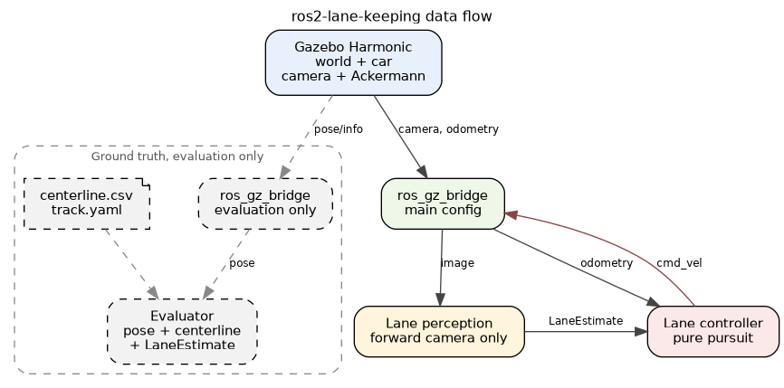

# Architecture



## Processes

| Process | Input | Output |
|---|---|---|
| Gazebo world | World and car SDF | Camera images, odometry, model pose |
| Main bridge | Gazebo topics | `/car/camera/image_raw`, `/car/odometry`, `/clock` |
| Lane perception | Camera images | `/car/lane_estimate`, `/car/debug_image` |
| Lane controller | `LaneEstimate`, odometry | `/car/cmd_vel` |
| Evaluation bridge | Gazebo `pose/info` | `/evaluation/model_poses` |
| Evaluator | Model pose, centerline, `LaneEstimate` | JSON, CSV, summary table |
| Foxglove bridge (optional) | ROS topics | `ws://localhost:8765` |

The launch file `demo.launch.py` starts the world, main bridge, perception,
and controller. The evaluator and its bridge run only in the scenario runner.
The Foxglove bridge is an optional read-only visualization path; perception and
control do not use it. See [`interface.md`](interface.md).

## Ground-truth isolation

Perception subscribes only to `/car/camera/image_raw`. The controller
subscribes only to `/car/lane_estimate` and `/car/odometry`. Neither file
contains a centerline path or a model-pose subscription.

The evaluation bridge is in a separate config file,
`config/eval_bridge.yaml`. The evaluator reads the generated
`centerline.csv` and `track.yaml` only to score a completed run.

## Perception summary

The camera is fixed at 1.3 m, pitched 0.05 rad down, with a 90° horizontal
field of view. Each pixel is projected onto the ground plane using the camera
height and intrinsics. Bright, low-saturation pixels inside a 3.5–12 m road
ROI are grouped into the two largest marking components. Each component gets a
robust quadratic fit `y(x)`. The lane center at the 4 m camera lookahead is
`(left + right) / 2`.

The full stages, validity checks, and equations are in
[`perception.md`](perception.md).

## Control summary

The controller uses pure pursuit:

```text
κ = 2y / (x² + y²)
ω = v · κ
```

The speed ramps from zero at 0.6 m/s² to 1.5 m/s. Curvature is limited to
0.15 1/m, yaw rate to 0.6 rad/s, and yaw commands pass through a first-order
smoother. The controller publishes zero speed when the lane estimate is
invalid, missing, or older than 0.3 s, or when odometry is stale.

The full parameter table and stop behavior are in [`control.md`](control.md).

## Topics

| Topic | Type | Direction |
|---|---|---|
| `/clock` | `rosgraph_msgs/msg/Clock` | Gazebo → ROS |
| `/car/camera/image_raw` | `sensor_msgs/msg/Image` | Gazebo → ROS |
| `/car/camera/camera_info` | `sensor_msgs/msg/CameraInfo` | Gazebo → ROS |
| `/car/odometry` | `nav_msgs/msg/Odometry` | Gazebo → ROS |
| `/car/lane_estimate` | `auto_drive_sim_interfaces/msg/LaneEstimate` | Perception → controller |
| `/car/debug_image` | `sensor_msgs/msg/Image` | Perception → viewer |
| `/car/cmd_vel` | `geometry_msgs/msg/Twist` | Controller → Gazebo |
| `/evaluation/model_poses` | `tf2_msgs/msg/TFMessage` | Evaluation only |
