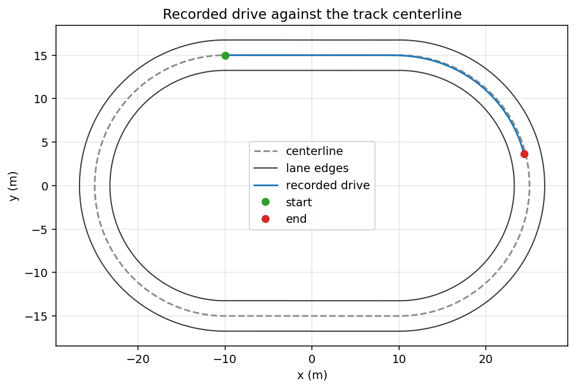
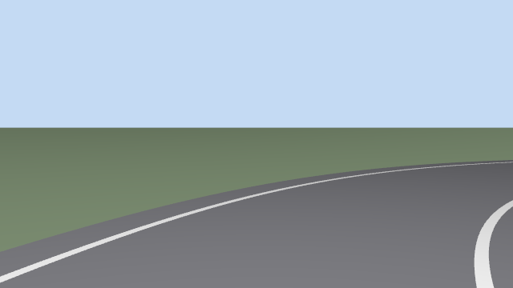

# Car

The first-release car is an original SDF model built from boxes and cylinders.
It uses Gazebo Harmonic's Ackermann steering system. It is not a model copied
from another project.

Status: the car is manually drivable along a straight and the east curve.
Perception and autonomous control are not implemented yet.

## Geometry and mass

| Item | Value |
|---|---|
| Body length | 3.8 m |
| Body width | 1.6 m |
| Body height | 0.5 m |
| Chassis mass | 700 kg |
| Wheelbase | 2.4 m |
| Wheel separation | 1.4 m |
| Wheel radius | 0.32 m |
| Wheel width | 0.2 m |
| Wheel mass | 12 kg each |
| Steering link mass | 1 kg each |
| Steering limit | ±0.55 rad |
| Tyre friction | μ = 1.0, μ₂ = 0.8 |
| Drive | Rear-wheel drive |
| Steering | Front-wheel Ackermann |

The model origin is at ground level between the wheels. Positive X is forward,
positive Y is left, and positive Z is up. The car is spawned at the track start
`(-10.0, 15.0, 0.05)` with yaw `0.0`, facing east along the top straight.

## Joints and plugin

Each front wheel has a steering link. The steering joints rotate about the
vertical (Z) axis with limits of ±0.55 rad. Each wheel spins about its axle.
The rear wheel joints are driven by:

```xml
<plugin filename="gz-sim-ackermann-steering-system"
        name="gz::sim::systems::AckermannSteering">
  <left_joint>rear_left_wheel_joint</left_joint>
  <right_joint>rear_right_wheel_joint</right_joint>
  <left_steering_joint>front_left_wheel_steering_joint</left_steering_joint>
  <right_steering_joint>front_right_wheel_steering_joint</right_steering_joint>
  <kingpin_width>1.4</kingpin_width>
  <steering_limit>0.55</steering_limit>
  <wheel_base>2.4</wheel_base>
  <wheel_separation>1.4</wheel_separation>
  <wheel_radius>0.32</wheel_radius>
  <min_velocity>-1.0</min_velocity>
  <max_velocity>3.0</max_velocity>
  <min_acceleration>-1.5</min_acceleration>
  <max_acceleration>1.5</max_acceleration>
  <odom_publish_frequency>20</odom_publish_frequency>
  <topic>/car/cmd_vel</topic>
  <odom_topic>/car/odometry</odom_topic>
  <tf_topic>/car/odom_tf</tf_topic>
</plugin>
```

## Camera

The forward RGB camera is mounted on a mast on the chassis.

| Item | Value |
|---|---|
| Position | 1.4 m forward, 1.3 m above ground |
| Pitch | 0.05 rad down |
| Resolution | 640 × 360 |
| Rate | 15 Hz |
| Horizontal field of view | 60° |
| Gazebo topic | `/car/camera/image_raw` |
| ROS topic | `/car/camera/image_raw` |


The camera image shows the lane ahead with both boundary lines and no part of
the car body in view.

## ROS interface

The bridge mappings are in
[`src/auto_drive_sim/config/bridge.yaml`](../src/auto_drive_sim/config/bridge.yaml).
This file is the single source of truth for topic names and directions.

| ROS topic | Type | Direction |
|---|---|---|
| `/clock` | `rosgraph_msgs/msg/Clock` | Gazebo → ROS |
| `/car/camera/image_raw` | `sensor_msgs/msg/Image` | Gazebo → ROS |
| `/car/camera/camera_info` | `sensor_msgs/msg/CameraInfo` | Gazebo → ROS |
| `/car/odometry` | `nav_msgs/msg/Odometry` | Gazebo → ROS |
| `/car/cmd_vel` | `geometry_msgs/msg/Twist` | ROS → Gazebo |

The Ackermann odometry is local to the spawn pose: the first message reports
position `(0, 0, 0)` and identity orientation. Gazebo model pose remains the
ground-truth source for the evaluator and is not used by perception or control.

## Manual driving

Start the world, bridge, and optional teleop node:

```bash
ros2 launch auto_drive_sim manual_drive.launch.py gui:=false teleop:=true
```

The teleop node is interactive and needs a terminal. Without one, run it in a
second terminal after starting the launch without `teleop:=true`:

```bash
ros2 launch auto_drive_sim manual_drive.launch.py gui:=false
ros2 run auto_drive_sim teleop
```

Keys: `w` forward, `s` reverse, `a` left, `d` right, space stop, `q` quit.

A fixed command can be sent without a keyboard:

```bash
ros2 run auto_drive_sim teleop --linear 0.5 --angular 0.0 --duration 2.0
```

`linear` is metres per second and `angular` is the commanded yaw rate in radians
per second. The node sends a stop command before it exits.

The teleop node can also run a continuous command sequence and record odometry:

```bash
ros2 run auto_drive_sim teleop \
  --segments "1.5,0,14.9;1.5,-0.1,16.0" \
  --tail 2.0 \
  --record /tmp/drive.csv
```

The record has `t_s, x_m, y_m, yaw_rad, vx_mps, wz_radps` from
`/car/odometry`. To compare it with the track:

```bash
python3 tools/analyze_drive.py --drive /tmp/drive.csv --output /tmp/drive.png
```

The analysis transforms local odometry to the world frame and reports centerline
error. It is a verification tool; the controller will not use the centerline.

## Model and topic checks (Step 6)

These checks verify the model, spawn, and topic plumbing.

| Check | Result |
|---|---|
| Car SDF validates | Yes |
| Car world validates | Yes |
| Car spawns at the start | Yes, ground truth `(-10.0, 15.0, -0.02)` after settling |
| `/clock` present | Yes |
| `/car/camera/image_raw` present | Yes |
| `/car/camera/camera_info` present | Yes |
| `/car/odometry` present | Yes |
| `/car/cmd_vel` present | Yes |
| Camera stream | 49 frames in 4 s, 640 × 360, 12.22 Hz wall, 14.84 Hz timestamps |
| Forward command path | 0.5 m/s for 2 s moved odometry 0.6355 m |
| Ground-truth motion | x changed from −10.0 to −9.3645 at y = 15.0 |
| Camera orientation | Start straight visible with both boundaries |

## Manual driving checks (Step 7)

I ran a short sign-and-stop sequence and a straight-plus-curve drive in the
Docker environment.

| Check | Result |
|---|---|
| Forward command | Odometry x increased; wheels rotate forward |
| Positive angular command | Yaw increases (left turn) |
| Negative angular command | Yaw rate becomes negative (right turn) |
| Stop command | Final speed 0.0 m/s, pose stable |
| Straight + east curve | 39.648 m in 27.65 s of simulated time |
| Heading change through the curve | −1.310 rad |
| Maximum absolute centerline error | 0.188 m |
| 95th-percentile absolute error | 0.187 m |
| Mean absolute error | 0.073 m |
| Lane half-width | 1.75 m |
| Curve camera | 74 frames in 6 s, 640 × 360, 12.95 Hz wall, 15.15 Hz timestamps |

The car stayed inside the lane through the curve. The path and camera frame
below come from the same run.





The first curve attempt used −0.2 rad/s and cut inside with a 1.5 m error. The
track needs about −0.1 rad/s at 1.5 m/s. I also extended the straight segment
from 13.8 s to 14.9 s so the turn starts at the curve rather than 1.2 m early.
The final run is the one in the table.

This is still a scripted manual command sequence, not lane keeping. Perception
and control are the next milestone.
