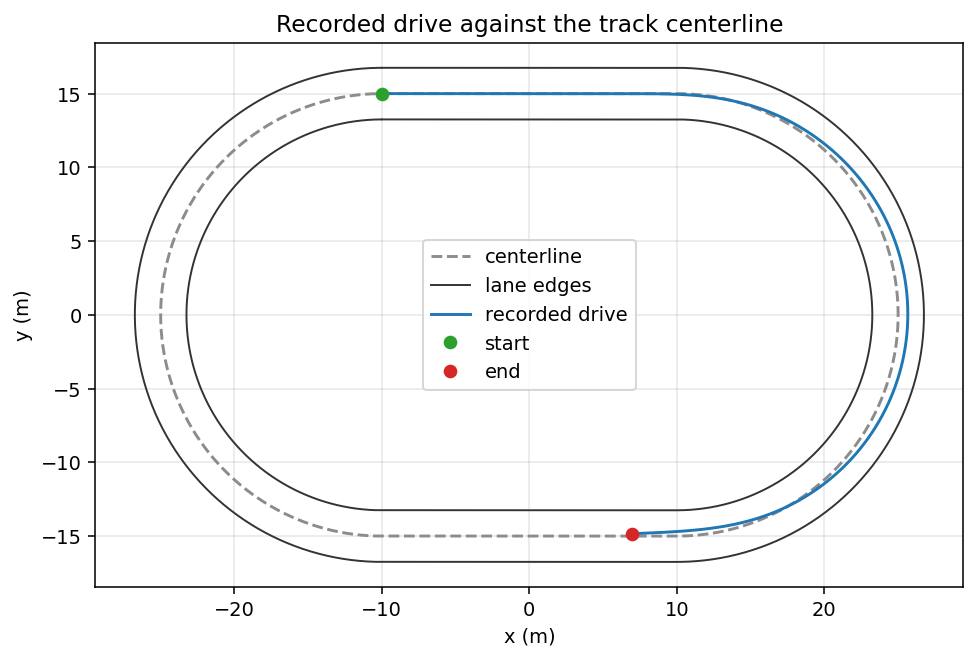
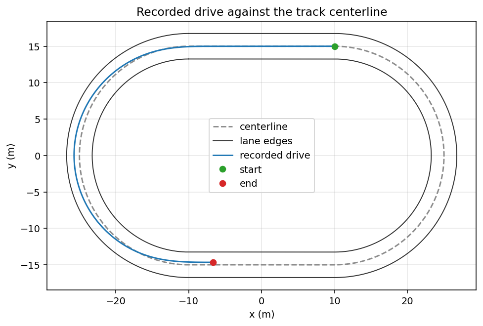
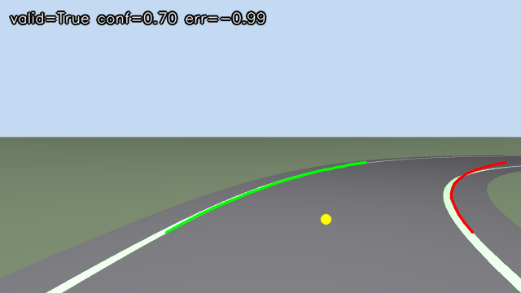

# Lane controller

The controller is a separate node. It consumes only:

- `/car/lane_estimate`
- `/car/odometry`

It publishes `/car/cmd_vel`. It does not read the track centerline, the Gazebo
model pose, or any simulator ground truth.

## Pure pursuit

The perception node gives a lookahead point `(x, y)` in vehicle coordinates.
The controller computes curvature:

```text
κ = 2y / (x² + y²)
```

and yaw rate:

```text
ω = v · κ
```

A positive `y` is left of the car, so positive curvature and positive yaw rate
are left turns. The command is bounded before it reaches the Ackermann plugin.

The perception lookahead target is 4 m ahead of the camera. In vehicle
coordinates that is `x = 5.4 m`. `lookahead_gain` scales that point for tuning;
the default is `1.0`.

## Speed and smoothing

- Target speed: 1.5 m/s in the release run.
- Acceleration ramp: 0.6 m/s² from standstill.
- Deceleration ramp: 1.0 m/s².
- Lateral acceleration limit: 0.15 m/s².
- Minimum curve speed: 0.6 m/s.
- Yaw-rate limit: 0.6 rad/s.
- Yaw-acceleration limit: 1.5 rad/s².
- Curvature limit: 0.15 1/m.
- Yaw smoothing: first-order low pass with alpha 0.35 at 20 Hz.
- Long-loss recovery: after a stop of at least 0.5 s, speed is capped at
  0.8 m/s for 1.0 s before normal speed planning resumes.

The speed does not jump to the target. It ramps from zero and resets to zero
after a stop, so recovery also ramps.

## Curve speed planning

The curvature from the lookahead point sets a speed limit:

```text
v_curve = sqrt(a_lat / |κ|)
v_limit = min(v_target, max(v_min, v_curve))
```

The speed moves toward `v_limit`:

```text
v < v_limit:  v = min(v_limit, v + a_accel · dt)
v ≥ v_limit:  v = max(v_limit, v − a_decel · dt)
```

On the 15 m oval curves, `v_curve` is 1.5 m/s. At the release target of
1.5 m/s, the limiter does not change the release results. At an optional
2.0 m/s target, the car runs 2.0 m/s on the straights and about 1.5 m/s in the
curves. That profile completed all three solid-track scenarios at 81.00 s,
84.44 s, and 82.66 s.

## Lead vehicle

The controller subscribes to `/car/lead_distance` (`std_msgs/Float32`). If the
message is fresh (0.5 s), it applies a follow-speed cap:

```text
v_lead = max(0, (distance − gap) · gain)
v_limit = min(v_curve, v_lead)
```

The default gap is 6.0 m and the gain is 0.8 1/s. At or below the gap the
controller commands zero speed and reports `lead_vehicle`.

## Stop conditions

The controller publishes zero speed and zero yaw when:

| Status | Cause |
|---|---|
| `no_lane_estimate` | No estimate has arrived |
| `lane_invalid` | Perception reported `valid=false` |
| `stale_lane_estimate` | Estimate is older than 0.3 s |
| `no_odometry` | No odometry has arrived |
| `stale_odometry` | Odometry is older than 0.3 s |
| `lead_vehicle` | Lead vehicle is at or below the follow gap |
| `bad_lookahead` | Target is behind or non-finite |

Perception republishes the last valid estimate for up to 0.25 s on a brief
invalid frame. The message keeps its original header stamp, so this controller
still stops once the estimate is older than 0.3 s. The evaluator counts only
fresh valid estimates.

The Ackermann plugin has its own acceleration limit, so the physical car takes
a moment to stop after the command reaches zero. In the stop test the measured
speed went from 1.5 m/s to 0.0 m/s.

## Parameters

| Parameter | Default |
|---|---:|
| `target_speed_mps` | 1.5 |
| `max_acceleration_mps2` | 0.6 |
| `max_deceleration_mps2` | 1.0 |
| `max_lateral_acceleration_mps2` | 0.15 |
| `min_curve_speed_mps` | 0.6 |
| `max_curvature_1pm` | 0.15 |
| `max_yaw_rate_radps` | 0.6 |
| `max_yaw_acceleration_radps2` | 1.5 |
| `lookahead_gain` | 1.2 |
| `yaw_smoothing_alpha` | 0.35 |
| `long_loss_s` | 0.5 |
| `recovery_speed_mps` | 0.8 |
| `recovery_hold_s` | 1.0 |
| `max_lane_age_s` | 0.3 |
| `max_odom_age_s` | 0.3 |
| `command_rate_hz` | 20 |

## Run the demo

```bash
ros2 launch auto_drive_sim demo.launch.py gui:=false
```

The demo starts the world, bridge, perception node, and controller. To run the
world and perception without the controller:

```bash
ros2 launch auto_drive_sim demo.launch.py gui:=false controller:=false
```

Record a drive:

```bash
python3 tools/record_odometry.py --duration 50 --output /tmp/drive.csv
python3 tools/analyze_drive.py --drive /tmp/drive.csv --output /tmp/drive.png
```

The recorder uses odometry timestamps, so the duration is in simulated time.

## Tests

The controller tests cover:

- straight lookahead,
- left and right curvature signs,
- excessive curvature,
- yaw-rate limiting,
- bad lookahead,
- stale lane estimate,
- stale odometry,
- lost lane,
- speed ramp,
- recovery ramp,
- yaw smoothing.

The repository suite has 83 tests:

```bash
./docker/run.sh bash -lc 'python3 -m pytest -q tests'
```

## Live results

The final full-lap release scenarios are in
[`docs/evaluation.md`](evaluation.md). The two runs below are shorter
controller checks from the previous milestone; both lasted 50 simulated
seconds and used the 1.5 m/s target.

| Run | Distance | Heading change | Max centerline error | p95 | Mean |
|---|---:|---:|---:|---:|---:|
| Clockwise, east/right curve | 71.034 m | −3.105 rad | 0.658 m | 0.649 m | 0.238 m |
| Counterclockwise, west/left curve | 71.496 m | +3.144 rad | 0.737 m | 0.727 m | 0.273 m |

Both runs started centered and stayed under 0.75 m centerline error. They
completed a straight and a full 180° curve in opposite directions. The
controller logged no invalid or stale stops during either run.





The debug frame during the clockwise curve shows both boundary fits and the
lookahead target:



For the perception-loss test, the car was at 1.5 m/s when the perception node
was stopped. Four seconds later the measured speed was 0.0 m/s and the
controller state was `stale_lane_estimate`.

## Limitations

- Pure pursuit uses the single camera lookahead point; it does not smooth a
  predicted path.
- Speed is constant until a stop. There is no curve speed planning yet.
- The controller stops on perception loss and ramps on recovery; it does not
  coast through short gaps.
- Centerline error is not yet the release metric. The 95th-percentile lap
  target and footprint boundary checks belong to Milestone 5.
