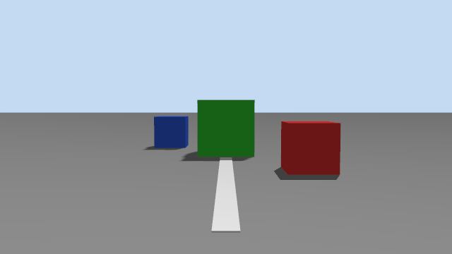

# Environment

**Status: CAMERA GATE PASSED IN DOCKER, NOT IN THE PLANNED VM.** The workspace
builds and Gazebo publishes real camera frames through ROS 2 in the Docker
environment below. The target Ubuntu 24.04 ARM64 VM has not been tested.
Milestone 1 may start on the strength of the Docker result, but every later
result must keep the Docker deviation labelled.

## Target environment

| Item | Planned value |
|---|---|
| OS | Ubuntu 24.04 ARM64 |
| ROS 2 | Jazzy |
| Simulator | Gazebo Harmonic |
| Python | 3.12 (Ubuntu 24.04 system Python) |
| Host | macOS on Apple Silicon |

## Working environment decision

The plan calls for an Ubuntu 24.04 ARM64 VM. During implementation I chose to
run the Linux environment in Docker on the macOS host instead, because no VM
image was available on the machine. This is a deviation from the plan. Results
measured in Docker must be labelled as such and must not be presented as VM
results.

The Docker environment did render camera frames, so the Milestone 0 gate was
not blocked. The VM camera check remains an open verification item.

## Installation

The environment is defined in [`docker/Dockerfile`](../docker/Dockerfile) and
built with:

```bash
./docker/run.sh
```

The image uses `ubuntu:24.04` (arm64) and follows the official ROS 2 Jazzy
Ubuntu instructions:

1. Add the ROS 2 apt source package (`ros2-apt-source` 1.3.0) from the
   [ros-infrastructure release](https://github.com/ros-infrastructure/ros-apt-source/releases).
2. Install `ros-jazzy-ros-base` from `packages.ros.org`.
3. Install `ros-jazzy-ros-gz`, which brings the Gazebo Harmonic libraries as
   ROS vendor packages, plus `ros-jazzy-gz-tools-vendor` and
   `ros-jazzy-gz-sim-vendor`.

I did not install `gz-harmonic` from `packages.osrfoundation.org` on top of the
vendor packages. The [ROS/Gazebo pairing documentation](https://gazebosim.org/docs/harmonic/ros_installation/)
recommends `ros-${ROS_DISTRO}-ros-gz` as the supported combination, and mixing
both sources risks package conflicts.

The build is run with:

```bash
colcon build --symlink-install
source install/setup.bash
```

## Camera feasibility check

The check uses [`tests/gazebo/camera_check.sdf`](../tests/gazebo/camera_check.sdf),
a static scene with a white ground stripe and blue, green, and red boxes in
front of a 1.3 m high camera. The camera renders 640 × 360 at 15 Hz.

Run it with:

```bash
tools/run_camera_check.sh
```

The script starts Gazebo headlessly, bridges the Gazebo image topic to ROS 2,
runs [`tools/camera_probe.py`](../tools/camera_probe.py), and saves one frame.
The probe exits non-zero when frames are missing, the dimensions are wrong, or
the image is nearly uniform.

### Gate result

Measured on 2026-11-13 in the Docker container:

| Check | Result |
|---|---|
| Gazebo starts headlessly | Yes, `gz sim -s -r --headless-rendering` |
| Camera publishes through ROS 2 | Yes, 139 frames in a 10 s probe |
| Gazebo image topic | `/camera_check/image` |
| ROS image topic | `/camera_check/image` |
| Camera info topic | `/camera_check/camera_info` |
| Image dimensions | 640 × 360 |
| Frame rate, message timestamps | 15.15 Hz |
| Frame rate, wall clock | 13.93 Hz over 9.906 s |
| Pixel contrast | BGR standard deviation 65.70 / 51.56 / 42.60 |
| Probe verdict | `valid: true` |



The frame shows the white stripe and all three boxes with correct colours and
shadows. This is a real rendered frame, not a placeholder image.

**Limit:** this is a Docker result on the macOS host. It does not replace the
VM check required by the plan.

## Observed results

| Item | Observed value |
|---|---|
| Architecture | aarch64 |
| Ubuntu version | Ubuntu 24.04.5 LTS |
| ROS 2 distribution | Jazzy, `ros-jazzy-ros-base` 0.11.0, `ros-jazzy-ros2cli` 0.32.13 |
| ROS–Gazebo bridge | `ros-jazzy-ros-gz` 1.0.24 |
| Gazebo version | Gazebo Sim 8.15.0 (Harmonic vendor packages) |
| Python version | 3.12.3 |
| Rendering engine | OGRE2, EGL 1.5 surfaceless |
| Rendering backend | Mesa llvmpipe (LLVM 20.1.2), software |
| Camera topic | Gazebo and ROS `/camera_check/image` |
| Image dimensions | 640 × 360 |
| Frame rate | 13.93 Hz wall clock, 15.15 Hz message timestamps |
| GUI | Not tested; the container has no display |

## Build and test results

```text
Starting >>> auto_drive_sim_interfaces
Finished <<< auto_drive_sim_interfaces [4.60s]
Starting >>> auto_drive_sim
Finished <<< auto_drive_sim [0.84s]

Summary: 2 packages finished [5.52s]
```

`ros2 pkg list` reports both `auto_drive_sim` and
`auto_drive_sim_interfaces`, and
`ros2 interface show auto_drive_sim_interfaces/msg/LaneEstimate` prints the
expected fields.

## Failures and revisions

- Initial `colcon build` failed because `catkin_pkg` rejected the maintainer
  email `evangelos@localhost`. I replaced it with the reserved placeholder
  `evangelos.kostakis@example.com` in both `package.xml` files and `setup.py`.
  The build then completed.
- The first camera-check run failed because `set -u` in the runner conflicted
  with `/opt/ros/jazzy/setup.bash`. I disabled nounset while sourcing ROS.
- The first successful probe emitted a NumPy deprecation warning from
  `float(max(std))`. I changed it to `float(std.max())` and reran the probe.

## Rendering issues and limitations

- Rendering uses the CPU-only Mesa llvmpipe driver. The wall-clock rate of
  13.93 Hz is close to the configured 15 Hz, but later tests must use simulation
  time rather than wall time.
- Gazebo logged one benign warning from `Ogre2Camera::SetVisibilityMask` about
  reserved mask bits. It did not affect the frames.
- The Gazebo GUI is not available in this Docker setup. Only headless operation
  is supported here.
- The target VM may use hardware rendering and produce different rates. Do not
  copy these numbers into VM results.

## Commands run

```bash
docker build --progress=plain -t auto-drive-sim:jazzy-harmonic -f docker/Dockerfile .
./docker/run.sh bash -lc 'gz sim --version'
./docker/run.sh bash -lc 'colcon build --symlink-install'
./docker/run.sh bash -lc 'tools/run_camera_check.sh'
./docker/run.sh bash -lc 'LIBGL_ALWAYS_SOFTWARE=1 eglinfo'
```

`ros2 --version` is not accepted by ROS 2 Jazzy; package metadata is used for
the version table instead.
