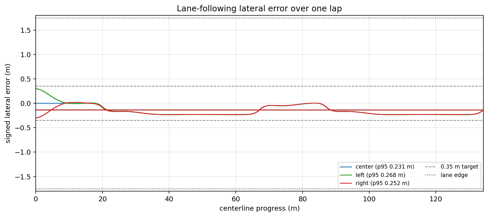

# Evaluation

The release scenarios use Gazebo model pose and the generated centerline only
inside the evaluator. The perception and controller nodes never subscribe to
either.

The raw results are in [`results/`](../results/). The runner writes one JSON
result and one lateral-error CSV per scenario, plus
[`results/summary.md`](../results/summary.md).

## Setup

| Item | Value |
|---|---|
| Environment | Docker on macOS arm64 |
| OS | Ubuntu 24.04.5 arm64 |
| ROS 2 | Jazzy |
| Simulator | Gazebo Sim 8.15.0 |
| Track | version 1, 134.248 m centerline |
| Lane width | 3.5 m between marking inner edges |
| Vehicle | 3.8 × 1.6 m, 2.4 m wheelbase |
| Camera | 640 × 360, 90° horizontal FOV, 1.3 m high |
| Controller speed | 1.5 m/s |
| Lookahead gain | 1.2 |
| Speed ramp | 0.6 m/s² |
| Curvature limit | 0.15 1/m |
| Yaw-rate limit | 0.6 rad/s |
| Yaw smoothing | alpha 0.35 at 20 Hz |
| Scenario timeout | 130 simulated seconds |

The scenarios use the same world with the car placed at:

- center: `y = 15.0`
- left: `y = 15.3`
- right: `y = 14.7`

All three start at `x = -10.0` with yaw `0.0`.

The evaluator bridge is
[`src/auto_drive_sim/config/eval_bridge.yaml`](../src/auto_drive_sim/config/eval_bridge.yaml).
It maps `/world/car_world/pose/info` to `/evaluation/model_poses`. The normal
bridge used by perception and control does not include it.

## Metrics

- **Lap completion**: cumulative centerline progress reaches the full
  134.248 m. Progress is unwrapped at the start line, so spinning near the
  start does not count.
- **Lap time**: simulated time from the first 0.5 m of progress to the lap
  finish. The initial stationary wait is excluded.
- **Lateral error**: signed distance from the car origin to the nearest
  centerline sample. The table reports mean absolute, 95th-percentile
  absolute, and maximum absolute error.
- **Boundary crossing**: all four corners of the 3.8 × 1.6 m footprint are
  checked against the ±1.75 m lane edges. A single corner outside counts as a
  crossing.
- **Perception valid**: percentage of `LaneEstimate` messages with
  `valid=true` during the run.
- **Stop events**: command speed transitions from above 0.2 m/s to at most
  0.05 m/s after the car has moved.

The evaluator uses simulated time. A slower renderer changes wall-clock
duration, not the metric timeline.

## Results

| Scenario | Lap | Lap time (s) | Mean error (m) | p95 error (m) | Max error (m) | Crossing | Valid (%) | Stops |
|---|---:|---:|---:|---:|---:|---:|---:|---:|
| center | yes | 87.87 | 0.147 | 0.231 | 0.232 | no | 100.0 | 0 |
| left +0.3 m | yes | 87.88 | 0.168 | 0.268 | 0.300 | no | 100.0 | 0 |
| right −0.3 m | yes | 87.87 | 0.168 | 0.252 | 0.300 | no | 100.0 | 0 |

Release target: **PASS**.

- All three laps completed.
- No footprint corner crossed either lane edge.
- All three p95 values are below 0.35 m.



The first offset seconds on the left/right runs show the initial lateral offset
converging back to the lane center. The rest of the lap stays within the
±0.35 m target band.

## Tuning record

I tuned only the controller lookahead gain against the centered scenario. The
scenario definitions and evaluator were not changed between runs.

| Lookahead gain | p95 error (m) | Result |
|---:|---:|---|
| 1.0 | 0.434 | inside offset on both curves |
| 0.8 | 0.634 | worse corner cutting |
| 1.2 | 0.231 | used for the final runs |

A shorter lookahead made the inside offset worse. Increasing the gain to 1.2
gave the car a longer effective lookahead and reduced the curve error without
causing oscillation.

## Run it

```bash
./docker/run.sh bash -lc 'colcon build --symlink-install'
./docker/run.sh bash -lc 'tools/run_scenarios.sh'
cat results/summary.md
```

Run one scenario:

```bash
./docker/run.sh bash -lc 'tools/run_scenarios.sh center'
```

The runner writes generated worlds to `artifacts/scenarios/` and committed
results to `results/`.

## Limitations

- These results are from Docker on macOS, not the planned Ubuntu VM.
- The track is a clean, flat, one-lane oval with continuous white markings.
- There is no traffic, weather, occlusion, or dashed marking.
- The lateral error is measured to the nearest centerline sample; the footprint
  crossing check uses the same centerline.
- Meeting this target on this track is not a claim of road-ready autonomy.
