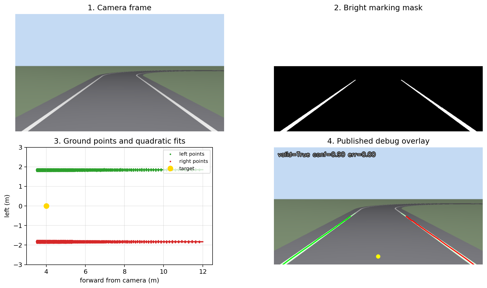
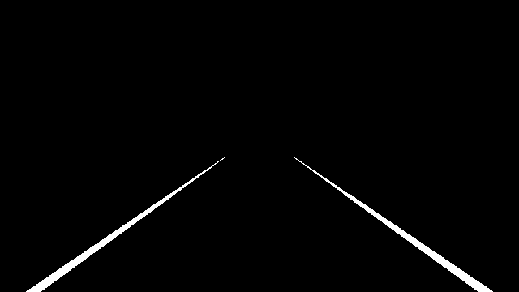
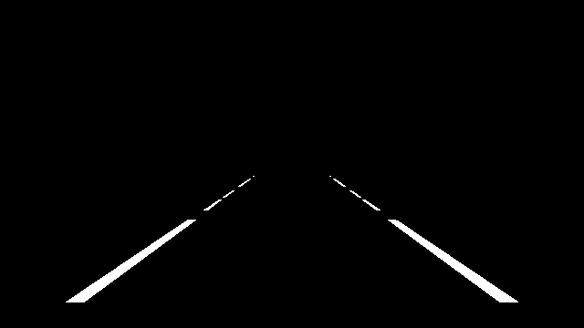
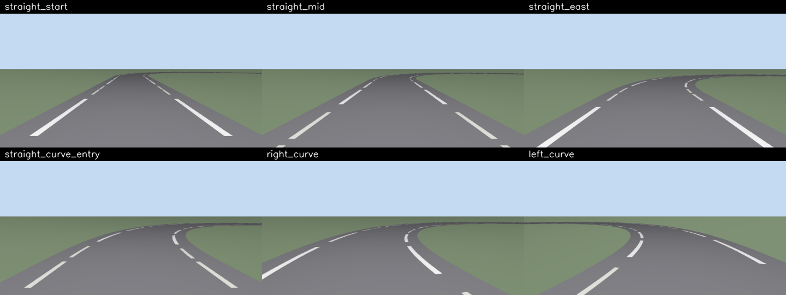
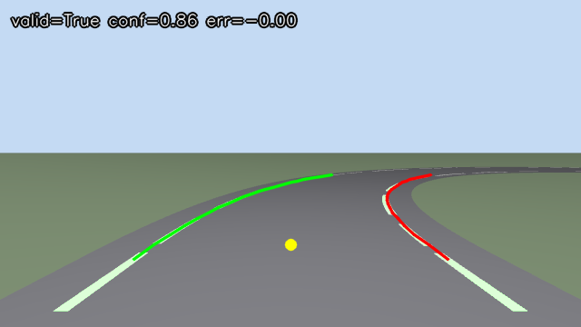
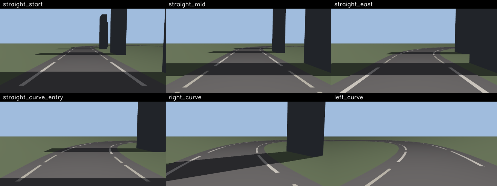
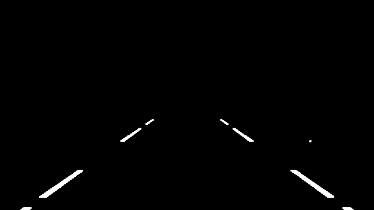
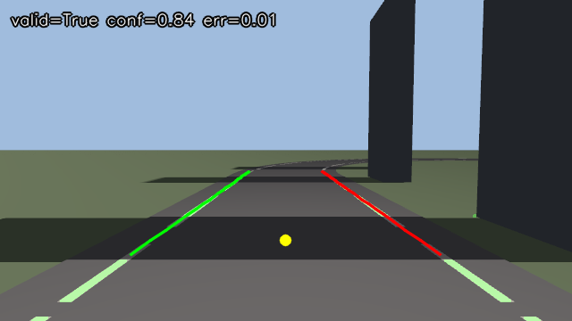
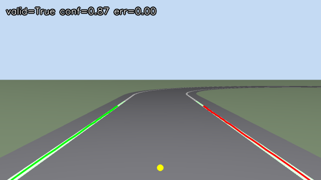

# Lane perception

The perception node uses only the forward camera image. It does not read
odometry, the simulator pose, or the track centerline.

The live node subscribes to `/car/camera/image_raw`, publishes
`auto_drive_sim_interfaces/msg/LaneEstimate` on `/car/lane_estimate`, and
publishes an overlay on `/car/debug_image`.

## Camera and ground plane

The camera is fixed at 1.3 m above the road, pitched 0.05 rad down, 1.4 m
ahead of the model origin. It produces 640 × 360 images with a 90° horizontal
field of view.

| Intrinsic | Value |
|---|---|
| `fx` | 320.00 px |
| `fy` | 320.00 px |
| `cx` | 320 px |
| `cy` | 180 px |

For a pixel `(u, v)`, the normalized camera coordinates are:

```text
a = (u - cx) / fx
b = (v - cy) / fy
```

In the camera frame with X forward, Y left, and Z up, the ray is
`(1, -a, -b)`. Rotating it by the pitch `p` gives a world-aligned direction.
The ground intersection at camera height `h = 1.3 m` is:

```text
t   = -h / ray_z
X   = t * ray_x
Y   = t * ray_y
```

Only rays with `ray_z < 0` reach the ground. The ROI is 3.5–15 m forward and
±8 m lateral. The wider ROI keeps the outer boundary in view on the curves.

The lookahead target is **4 m ahead of the camera**, which is 5.4 m ahead of
the model origin. The published target uses vehicle coordinates, so
`lookahead_target.x = 5.4`.

## Pipeline



The binary marking mask, with the sky area hidden for display, is:



On the dashed and worn variant, the same threshold gives:



1. **Mask the markings.** Convert to HSV and keep bright, low-saturation
   pixels: `V ≥ 180`, `S ≤ 60`. If that mask does not produce a valid lane,
   add a local-contrast pass: the value must exceed a 51 × 51 blurred
   background by 35, stay at `S ≤ 60` and `V ≥ 60`. A 3 × 3 opening removes
   isolated shadow edges. Lit frames stay on the global path.
2. **Project to the ground.** Use the fixed camera model to turn each mask
   pixel into a ground point. The sky produces no ground points, so it is
   ignored naturally.
3. **Cut the road ROI.** Keep points from 3.5 to 15 m forward and within ±8 m
   lateral.
4. **Find the two markings.** Keep connected white components with at least
   8 pixels and 5 ground points in the ROI. Dashed lines produce many pieces.
   Pair pieces with similar forward distance and a 2.0–6.0 m lateral
   separation, then assign the higher-lateral piece of each pair to the left
   boundary. Attach any remaining pieces to the nearer fitted side. With
   `lane_strategy=rightmost`, only the two rightmost components are kept; the
   two-lane world uses this to stay in the right lane.
5. **Fit each boundary.** Fit a quadratic `y(x)` with three residual-rejection
   passes when the points span at least 2.5 m. A single dash covering 1.0–2.5 m
   uses a line fit, and only when its nearest point is within 1.6 m of the 4 m
   target. Require at least 50 inliers and RMS error below 0.15 m.
6. **Validate and estimate.** Compute the lane width at the 4 m lookahead.
   Reject a pair that is swapped, narrower than 2.8 m, wider than 4.5 m, or
   has a center more than 2.5 m from the camera axis. The lateral error is the
   lane center at the 4 m camera lookahead.

The confidence combines boundary point count, fit RMS, and width error. It is
a relative quality score, not a probability.

The node rejects `valid=false` for these reasons:

| Reason | Cause |
|---|---|
| `no_lane_markings` | No marking points reach the ground ROI |
| `one_boundary` | Only one boundary was found |
| `sparse_boundaries` | Too few inliers, short span, or poor fit |
| `swapped_boundaries` | Left fit is not left of the right fit |
| `lane_too_narrow` / `lane_too_wide` | Width outside 2.8–4.5 m |
| `lane_offset_too_large` | Lane center more than 2.5 m from camera axis |
| `stale_image` | Image timestamp older than 0.3 s |

On a brief invalid frame, the node republishes the last valid estimate for up
to 0.25 s. The message keeps its original header stamp, so the controller still
stops once the estimate is older than 0.3 s. The evaluator counts only fresh
valid messages, not held ones.

## Lead-vehicle detector

A separate node, `lead_detector`, finds the red lead vehicle in the camera
image. It keeps red-orange pixels (`H` 0–25 or 160–180, `S ≥ 120`, `V ≥ 80`)
and applies a 3 × 3 opening. It projects the red pixels to the ground plane,
keeps points from 1 to 40 m forward and within ±6 m lateral, and requires at
least 10 points. The distance is the 5th percentile of the forward coordinate,
which is the near edge of the lead vehicle. The lead car has a low red rear
skirt so that edge sits at road level. It publishes `/car/lead_estimate` as
`auto_drive_sim_interfaces/LeadEstimate`.

The detector assumes a red lead vehicle and a flat road. It does not handle
occlusion or general obstacles.

## Saved frame tests

The test frames are in [`tests/frames/`](../tests/frames/). They were captured
from four static cameras using the same camera model as the car.


| Frame | Valid | Confidence | Lateral error | Line-center width |
|---|---:|---:|---:|---:|
| Straight | yes | 0.895 | 0.006 m | 3.672 m |
| Right curve | yes | 0.881 | +1.083 m | 3.702 m |
| Left curve | yes | 0.880 | −1.071 m | 3.701 m |
| No line | no | 0.000 | — | — |

The right-curve error is positive because the lane is to the left of the
camera aim after the camera is pointed into the right bend. The left curve is
the opposite.

Additional rejection tests cover a blank frame, a frame with one boundary
removed, narrow and wide lane fits, swapped boundaries, sparse points, and
stale timestamps. The suite also checks node wiring and evaluation failure handling.

### Dashed and worn frames

The dashed frame set is in
[`tests/frames_markings/`](../tests/frames_markings/). It uses the same camera
model at six poses on track version 2. The labels in
[`labels.json`](../tests/frames_markings/labels.json) are computed from the
generated offset centerlines at the 4 m lookahead.



| Frame | Valid | Confidence | Lateral error | Ground truth | Width | Ground truth |
|---|---|---:|---:|---:|---:|---:|
| Straight start | yes | 0.851 | 0.006 m | 0.000 m | 3.713 m | 3.660 m |
| Straight middle | yes | 0.859 | 0.007 m | 0.000 m | 3.711 m | 3.660 m |
| Straight east | yes | 0.846 | 0.011 m | 0.000 m | 3.711 m | 3.660 m |
| Curve entry | yes | 0.865 | −0.003 m | −0.010 m | 3.715 m | 3.663 m |
| Right curve | yes | 0.834 | 1.083 m | 1.069 m | 3.743 m | 3.688 m |
| Left curve | yes | 0.836 | −1.071 m | −1.069 m | 3.741 m | 3.688 m |

All six frames are valid. The largest lateral-error difference from ground
truth is 0.014 m and the largest width difference is 0.054 m.

The fitted boundaries on a dashed curve-entry frame:



### Shadow and low-light frames

The shadow set uses the same six poses under a low sun with shadow-casting
buildings. It is in [`tests/frames_lighting/`](../tests/frames_lighting/), with
labels in [`labels.json`](../tests/frames_lighting/labels.json).



| Frame | Valid | Confidence | Lateral error | Ground truth | Width | Ground truth |
|---|---|---:|---:|---:|---:|---:|
| Straight start | yes | 0.862 | 0.006 m | 0.000 m | 3.712 m | 3.660 m |
| Straight middle | yes | 0.844 | 0.010 m | 0.000 m | 3.712 m | 3.660 m |
| Straight east | yes | 0.742 | −0.014 m | 0.000 m | 3.690 m | 3.660 m |
| Curve entry | yes | 0.869 | −0.002 m | −0.010 m | 3.716 m | 3.663 m |
| Right curve | yes | 0.825 | 1.077 m | 1.069 m | 3.745 m | 3.688 m |
| Left curve | yes | 0.854 | −1.083 m | −1.069 m | 3.710 m | 3.688 m |

All six frames are valid. The largest lateral-error difference is 0.014 m and
the largest width difference is 0.057 m.

The shadowed mask, with the sky hidden, and the fitted boundaries:





The labeled frames pass. The full shadow world passed all three scenarios in
one recorded run: p95 errors 0.230 m (center), 0.249 m (left), and 0.300 m
(right), 96.4–96.9% fresh-valid perception, and 8–10 stop events. Repeat center
runs varied, so the shadow lap is a stress check and not repeatable yet. See
[`evaluation.md`](evaluation.md).

### Native low-sun baseline

The lane-keeping system (LKS) combines camera-based lane boundary detection
with lateral control to follow the lane center. Its current operational design
domain is a simulated road with painted white boundaries and a calibrated,
forward-facing camera; low sun and worn markings remain stress conditions.

On 2026-11-22, a native Metal run of `car_world_lighting.sdf` completed all
three laps without a footprint crossing. The center, left and right starts had
8, 7 and 8 stop events respectively, and 96.37%, 96.94% and 96.63% valid
perception messages. Their p95 absolute lateral errors were 0.2314 m, 0.2370 m
and 0.2350 m. This was a working-tree run adding world selection to the runner;
it is an exploratory baseline, not a clean-revision or repeatability claim.
Stop causes were not recorded, so the counts alone cannot establish whether
lane detection, stale input, or another condition caused each stop.

An instrumented follow-up on the same date completed all three laps with 8,
9 and 7 commanded stops. At 22 of the 24 stop observations, the latest raw
lane detection reported `sparse_boundaries`; the other two reported
`lane_too_wide`. Those observations are correlated with the stops, not proof
that each caused the stop. Controller state may have changed during braking;
use the timestamped transition history to inspect it. This was also an
exploratory working-tree run.

The evaluator saves `diagnostic_events.json` and a camera image at each
commanded stop in its scenario output. The event stream records changes in
controller state and raw invalid lane detections, including failures hidden by
the short estimate hold. Stop records include the latest observations and
their timestamps; the camera frame is the latest received, not necessarily
the exact frame that triggered the failure. These diagnostic outputs do not
alter perception, controller inputs, or the existing safe-stop thresholds.

Run the same stress world with the supervised native runner:

```bash
tools/native.sh python3 tools/native_check.py scenarios --world car_world_lighting.sdf
```

Run the perception tests:

```bash
./docker/run.sh bash -lc 'python3 -m pytest -q tests/test_lane_perception.py'
```

Recapture the saved frames:

```bash
./docker/run.sh bash -lc 'tools/capture_perception_frames.sh'
```

Recapture the dashed and worn set:

```bash
./docker/run.sh bash -lc \
  'CAMERAS="straight_start straight_mid straight_east straight_curve_entry right_curve left_curve" \
   tools/capture_perception_frames.sh tests/frames_markings tests/gazebo/markings_frames.sdf'
```

Recapture the shadow set:

```bash
./docker/run.sh bash -lc \
  'CAMERAS="straight_start straight_mid straight_east straight_curve_entry right_curve left_curve" \
   tools/capture_perception_frames.sh tests/frames_lighting tests/gazebo/lighting_frames.sdf'
```

## Live check

Start the world, bridge, and perception node:

```bash
./docker/run.sh bash -lc \
  'source install/setup.bash && ros2 launch auto_drive_sim perception.launch.py gui:=false'
```

At the start pose the live estimate was:

```text
valid: true
confidence: 0.868
reason: ""
lateral_error: 0.0062
lookahead_target:
  x: 5.4
  y: 0.0062
```

The debug image carried 38 frames in 4 s at 640 × 360, 12.17 Hz wall clock,
and 14.75 Hz message timestamps.



The green line is the fitted left boundary, the red line is the fitted right
boundary, and the yellow dot is the lookahead target.

## Revisions

The first live autonomy run stopped at the east curve because the 60° camera
saw only one boundary. I widened the camera to 90° and changed the boundary
extraction from per-distance pairing to two connected marking components. The
same run also showed that width measured at 4, 6, and 8 m grows on a curve, so
the width check now uses only the 4 m target.

The first dashed extractor kept the two largest connected components. Each
dash was a separate component, and a 1.5 m dash could not meet the 2.5 m span.
I changed the extractor to pair and join dash pieces, widened the pairing limit
for curve projection, and added the line fit for a single dash near the target.
Before those changes the car stopped at 16.4 m on the dashed track. With them it
completed all three track-version-2 laps with 100% valid estimates.

For shadows I added the local-contrast fallback and measured it on six labeled
frames. A brief invalid frame now holds the last valid estimate for up to
0.25 s, which removed the stop at the shadowed curve entry. I also prototyped a
single-boundary fallback that offset the visible line by the known lane width.
It reached further into the shadowed curve but caused a lane departure in
another run, so it is not in the shipped code.

## Limitations

- The method assumes a flat road and a fixed camera pitch. Body pitch from
  braking or acceleration will move the ground projection.
- The dashed variant uses 3 m dashes, 0.75 m gaps, and a fixed light wear
  pattern. Long gaps, heavy wear, and wet markings are not tested.
- Low-sun shadows pass with 8–10 stop events and 96.4–96.9% fresh-valid
  perception. A perception loss longer than the 0.25 s hold still stops the
  car, and driving from one visible boundary was not kept.
- The fitted width on a curve can be about 0.2 m wider than the true projected
  width. The controller uses the lane center, not this width.
- `lane_strategy=rightmost` assumes the car stays in the right lane of a
  two-lane road with solid boundaries. It does not choose or change lanes.
- The mark threshold is tuned for this scene. A different road material or
  lighting needs a new threshold.
- The camera cannot see the ground closer than about 3.4 m, so the lookahead is
  defined from the camera rather than the vehicle origin.
- `ros_gz_bridge` sometimes exits with a signal when the launch is interrupted
  in Docker. It does not affect the running estimate or the saved results.
