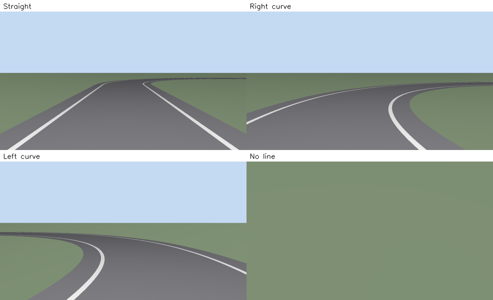

# Lane perception

The perception node uses only the forward camera image. It does not read
odometry, the simulator pose, or the track centerline.

The live node subscribes to `/car/camera/image_raw`, publishes
`auto_drive_sim_interfaces/msg/LaneEstimate` on `/car/lane_estimate`, and
publishes an overlay on `/car/debug_image`.

## Camera and ground plane

The camera is fixed at 1.3 m above the road, pitched 0.05 rad down, 1.4 m
ahead of the model origin. It produces 640 × 360 images with a 60° horizontal
field of view.

| Intrinsic | Value |
|---|---|
| `fx` | 554.25 px |
| `fy` | 554.25 px |
| `cx` | 320 px |
| `cy` | 180 px |

For a pixel `(u, v)`, the normalized camera coordinates are:

```text
a = (u - cx) / fx
b = (v - cy) / fy
```

In the camera frame with X forward, Y left, and Z up, the ray is
`(1, -a, -b)`. Rotating it by the pitch `p` gives a world-aligned direction.
The ground intersection at camera height `h = 1.3 m` is:

```text
t   = -h / ray_z
X   = t * ray_x
Y   = t * ray_y
```

Only rays with `ray_z < 0` reach the ground. The ROI is 3.5–12 m forward and
±5 m lateral.

The lookahead target is **4 m ahead of the camera**, which is 5.4 m ahead of
the model origin. The published target uses vehicle coordinates, so
`lookahead_target.x = 5.4`.

## Pipeline


1. **Mask the markings.** Convert to HSV and keep bright, low-saturation
   pixels: `V ≥ 180`, `S ≤ 60`. The road is grey and the markings are bright.
2. **Project to the ground.** Use the fixed camera model to turn each mask
   pixel into a ground point. The sky produces no ground points, so it is
   ignored naturally.
3. **Cut the road ROI.** Keep points from 3.5 to 12 m forward and within ±5 m
   lateral. Bin the points every 0.5 m along the road.
4. **Split left and right.** In each bin, cluster the lateral values with a
   0.25 m gap. Choose the pair whose separation is closest to 3.62 m
   (3.5 m lane plus 0.12 m marking width), and assign the higher-lateral
   cluster to the left boundary.
5. **Fit each boundary.** Fit a quadratic `y(x)` with three residual-rejection
   passes. Require at least 50 inliers, a 3 m forward span, and RMS error below
   0.15 m.
6. **Validate and estimate.** Compute the lane width at 4, 6, and 8 m. Reject
   a pair that is swapped, narrower than 2.8 m, wider than 4.5 m, or has a
   center more than 2.5 m from the camera axis. The lateral error is the lane
   center at the 4 m camera lookahead.

The confidence combines boundary point count, fit RMS, and width error. It is
a relative quality score, not a probability.

The node rejects `valid=false` for these reasons:

| Reason | Cause |
|---|---|
| `no_lane_markings` | No marking points reach the ground ROI |
| `one_boundary` | Only one boundary was found |
| `sparse_boundaries` | Too few inliers, short span, or poor fit |
| `swapped_boundaries` | Left fit is not left of the right fit |
| `lane_too_narrow` / `lane_too_wide` | Width outside 2.8–4.5 m |
| `lane_offset_too_large` | Lane center more than 2.5 m from camera axis |
| `stale_image` | Image timestamp older than 0.3 s |

## Saved frame tests

The test frames are in [`tests/frames/`](../tests/frames/). They were captured
from four static cameras using the same camera model as the car.



| Frame | Valid | Confidence | Lateral error | Line-center width |
|---|---:|---:|---:|---:|
| Straight | yes | 0.899 | 0.004 m | 3.664 m |
| Right curve | yes | 0.892 | +1.066 m | 3.687 m |
| Left curve | yes | 0.889 | −1.061 m | 3.691 m |
| No line | no | 0.000 | — | — |

The right-curve error is positive because the lane is to the left of the
camera aim after the camera is pointed into the right bend. The left curve is
the opposite.

Additional rejection tests cover a blank frame, a frame with one boundary
removed, narrow and wide lane fits, swapped boundaries, sparse points, and
stale timestamps. The test suite has 28 tests.

Run the perception tests:

```bash
./docker/run.sh bash -lc 'python3 -m pytest -q tests/test_lane_perception.py'
```

Recapture the saved frames:

```bash
./docker/run.sh bash -lc 'tools/capture_perception_frames.sh'
```

## Live check

Start the world, bridge, and perception node:

```bash
./docker/run.sh bash -lc \
  'source install/setup.bash && ros2 launch auto_drive_sim perception.launch.py gui:=false'
```

At the start pose the live estimate was:

```text
valid: true
confidence: 0.873
reason: ""
lateral_error: 0.0036
lookahead_target:
  x: 5.4
  y: 0.0036
```

The debug image carried 50 frames in 4 s at 640 × 360, 12.81 Hz wall clock,
and 14.85 Hz message timestamps.


The green line is the fitted left boundary, the red line is the fitted right
boundary, and the yellow dot is the lookahead target.

## Limitations

- The method assumes a flat road and a fixed camera pitch. Body pitch from
  braking or acceleration will move the ground projection.
- Only continuous white markings are handled. Dashed, worn, shadowed, or wet
  markings are later work.
- The mark threshold is tuned for this scene. A different road material or
  lighting needs a new threshold.
- The camera cannot see the ground closer than about 3.4 m, so the lookahead is
  defined from the camera rather than the vehicle origin.
- `ros_gz_bridge` sometimes exits with a signal when the launch is interrupted
  in Docker. It does not affect the running estimate or the saved results.
