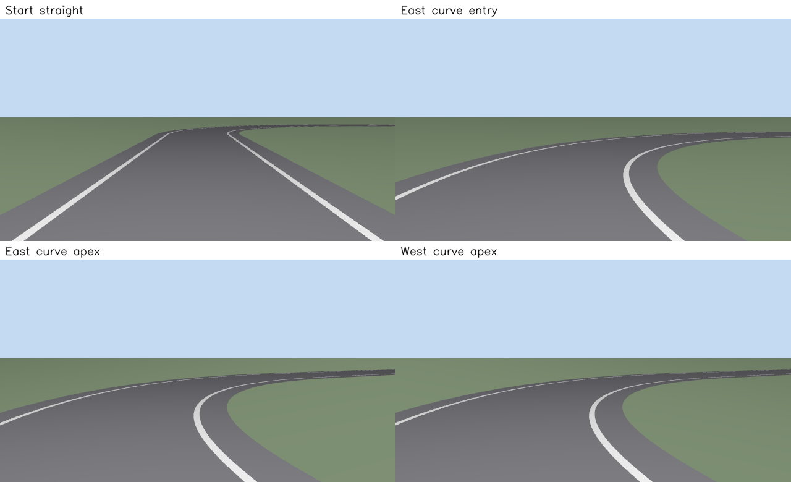

# Track

The first-release track is an original oval generated from
[`src/auto_drive_sim/config/track.yaml`](../src/auto_drive_sim/config/track.yaml).
It has two 20 m straights and two semicircular ends of 15 m radius. The clear
lane is 3.5 m wide between the inner edges of two continuous white boundary
strips.

This track is deliberately simple. It has no other lanes, no intersections, no
traffic, and no obstacles.

## Dimensions

| Item | Value |
|---|---|
| Straight length | 20.0 m each |
| Curve radius | 15.0 m |
| Centerline length | 134.24778 m |
| Lane width | 3.5 m between marking inner edges |
| Boundary marking width | 0.12 m |
| Shoulder each side | 0.75 m |
| Asphalt width | 5.0 m |
| Centerline sample spacing | 0.1 m |
| Centerline samples | 1342 |

## Coordinate frame

- The world origin is at the center of the oval at ground level.
- `+X` points east, `+Y` points north, and `+Z` points up.
- The centerline starts at `(-10.0, 15.0)` with yaw `0.0` and runs clockwise:
  - top straight from `x = -10` to `x = +10` at `y = +15`
  - east semicircle centered at `(+10, 0)` with radius 15 m
  - bottom straight from `x = +10` to `x = -10` at `y = -15`
  - west semicircle centered at `(-10, 0)` with radius 15 m
- The start pose from `track_meta.json` is `(-10.0, 15.0, 0.05)` with yaw
  `0.0`. The vehicle will face east along the top straight.
- The ground plane is at `z = -0.02`, the asphalt visual at `z = 0.005`, and
  the white marking visual at `z = 0.012`.

The road meshes are visual only. The physics ground is the flat plane, so a
future vehicle drives on the ground while the painted surface is slightly above
it.

`centerline.csv` stores one row per sample:

```text
s_m,x_m,y_m,yaw_rad,curvature_1_per_m
```

`yaw_rad` is counter-clockwise from `+X`. The clockwise oval therefore has
negative curvature on both curves and zero curvature on the straights.

## Generated assets

```text
src/auto_drive_sim/models/road/
├── model.config
├── model.sdf
├── track_meta.json
├── centerline.csv
└── meshes/
    ├── asphalt.obj
    ├── left_boundary.obj
    ├── right_boundary.obj
    └── road.mtl
```

The three meshes are closed triangle strips. Each boundary is one continuous
mesh around the whole oval, not one mesh per straight or curve, so there are no
mesh joints at the straight-to-curve transitions.

## Regenerating the assets

Run the generator from the repository root:

```bash
python3 tools/generate_track.py
```

Inside the Docker environment:

```bash
./docker/run.sh bash -lc 'python3 tools/generate_track.py'
```

Then run the geometry tests:

```bash
python3 -m pytest -q tests/test_track_geometry.py
```

The tests check the centerline length and closure, the start pose, the 3.5 m
lane width, the asphalt bounds and height, the curvature values, and that two
independent generations are byte-identical. One test also compares the
committed assets with a fresh generation, so stale assets fail the suite.

## Viewing the world

```bash
colcon build --symlink-install
source install/setup.bash
ros2 launch auto_drive_sim track_preview.launch.py gui:=false
```

The launch sets `GZ_SIM_RESOURCE_PATH` to the installed model directory and
bridges `/clock`. `gui:=true` starts the Gazebo client on a machine with a
display; the Docker environment on this Mac has no display.

## Camera verification

Run:

```bash
tools/run_road_camera_check.sh
```

The test world places four static cameras: the start straight, the east curve
entry, and the east and west curve apexes. Each camera is 640 × 360, 15 Hz,
with a 60° horizontal field of view.



Results from the 2026-11-13 Docker run:

| View | Frames in 6 s | Wall rate | Timestamp rate | Probe |
|---|---:|---:|---:|---|
| Start straight | 40 | 6.76 Hz | 9.85 Hz | valid |
| East curve entry | 35 | 6.28 Hz | 9.20 Hz | valid |
| East curve apex | 42 | 7.03 Hz | 10.35 Hz | valid |
| West curve apex | 57 | 10.12 Hz | 14.89 Hz | valid |

All four images show both boundary lines. The lines stay continuous through the
straight-to-curve transitions, which supports the no-seam requirement. Gazebo
reported no missing or failed assets.

The lower rates come from rendering four 640 × 360 cameras at once with the
CPU-only Mesa llvmpipe backend. The single-camera Milestone 0 check produced
15.15 Hz in the same container.

At the distant outer asphalt edge, the image shows a faint dashed fringe. It
appears to be subpixel aliasing of the road edge under software rendering, not
a gap in a lane marking; the white marking itself is continuous and inset from
that edge. Later perception work should not treat it as a lane feature.

## Limitations

- One lane only, with continuous boundaries and no center line.
- Flat road with uniform materials and no texture, wear, or dashed markings.
- The road is visual geometry without collision; the car will use the ground
  plane for physics.
- The Docker GUI path is untested.
